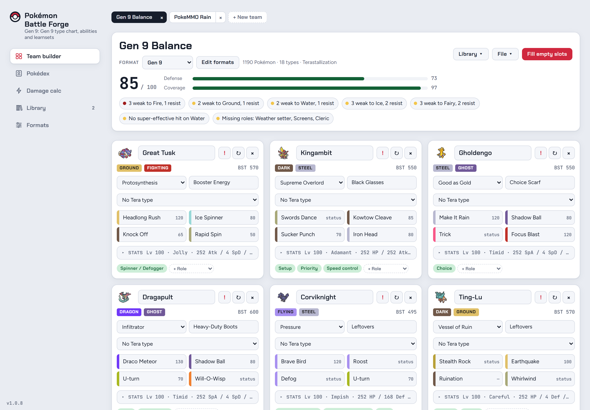
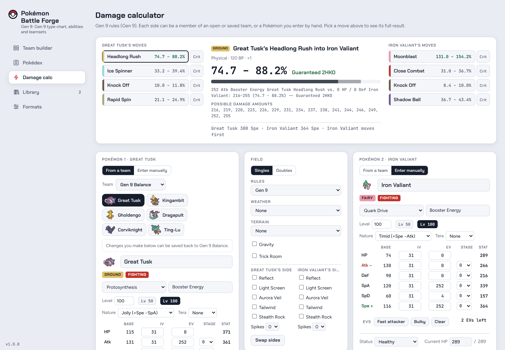
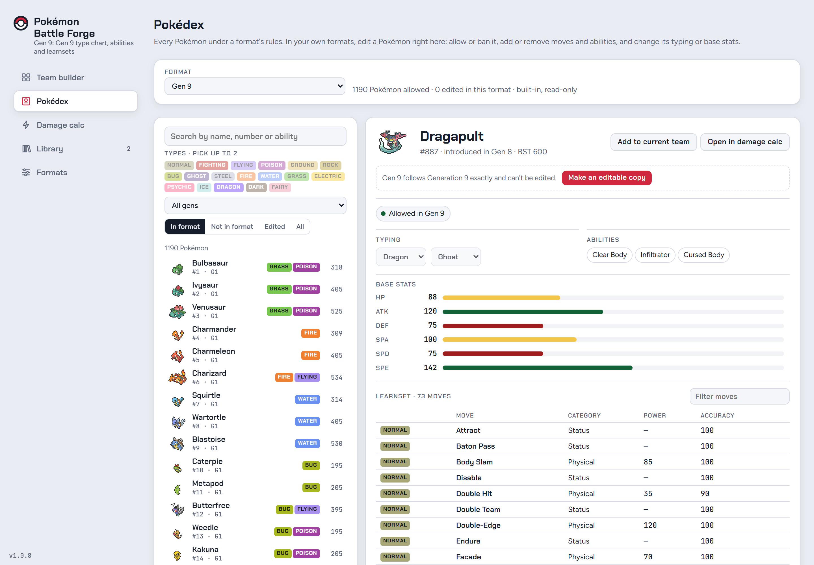
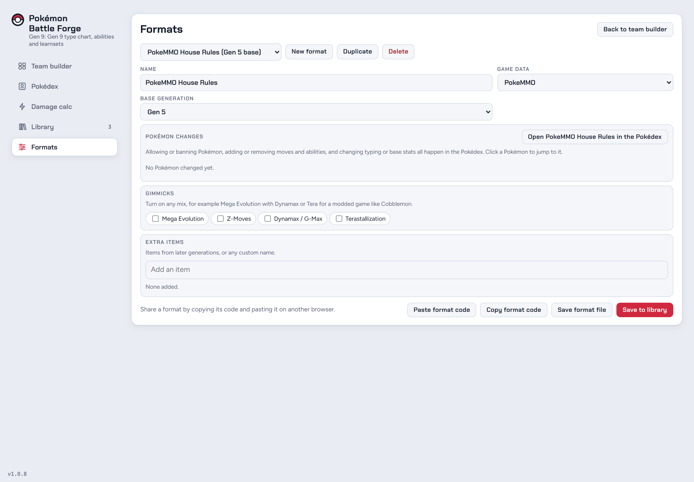
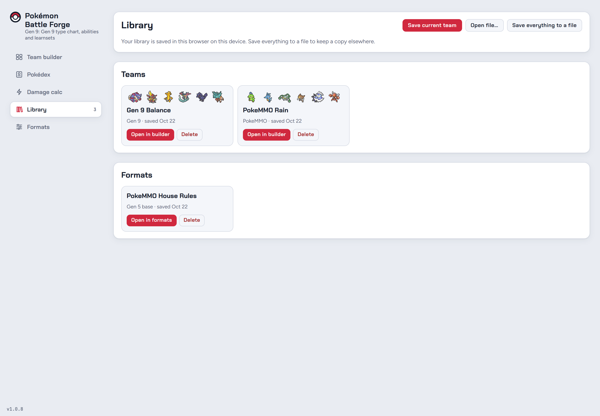

# Pokémon Battle Forge

A free, fan-made Windows app for building competitive Pokémon teams: a team builder, Pokédex and damage calculator in one,
for every generation from Gen 1 to Gen 9, with ready-made formats for **PokeMMO** and **Radical Red**.

**[Download the latest version](https://github.com/Venator8696/pokemon-battle-forge-releases/releases/latest)**

<picture>
  <source media="(prefers-color-scheme: dark)" srcset="screenshots/1-team-builder-dark.png">
  
</picture>

## Team builder

Pick six Pokémon with their abilities, items, moves, natures, EVs and IVs, and see right away how the team holds up:

- A team score with defense and coverage ratings, and warnings for stacked weaknesses or types you can't hit
- A roles checklist (hazards, hazard removal, pivots, setup, priority, speed control, cleric, screens and more)
  that fills in from each Pokémon's moves, ability and item
- A stats and speed table with final stats, sortable by any column
- Defense and move coverage charts, the Pokémon that wall your moves, and the threats that hit your team hardest
- Several teams open at once in tabs

[See the whole team builder page](screenshots/1b-team-builder-full-dark.png) ([light](screenshots/1b-team-builder-full-light.png))

## Damage calculator

<picture>
  <source media="(prefers-color-scheme: dark)" srcset="screenshots/2-damage-calc-dark.png">
  
</picture>

A Showdown-style calculator with both Pokémon side by side and every move's damage at a glance:

- Use a member of an open or saved team, or enter a Pokémon by hand, and save edits back to the team
- Weather, terrain, Trick Room, Gravity, singles or doubles, screens, hazards and each side's status and HP
- Critical hits, Z-Moves, Dynamax, Tera, multi-hit moves, moves that grow with each use, and abilities like Flash Fire
- The 16 damage rolls, KO chances and turn order, plus a matchup table for the whole team

## Pokédex

<picture>
  <source media="(prefers-color-scheme: dark)" srcset="screenshots/3-pokedex-dark.png">
  
</picture>

Browse every Pokémon under a format's rules: typing, abilities, base stats and full learnset. Filter by name, number,
ability, type and generation. In your own formats, edit a Pokémon right here: allow or ban it, add or remove moves and
abilities, or change its typing and base stats.

## Formats

<picture>
  <source media="(prefers-color-scheme: dark)" srcset="screenshots/4-formats-dark.png">
  
</picture>

Built-in formats for Gens 1–9, PokeMMO and Radical Red, using each game's own Pokémon, moves, abilities and items.
Make your own from any of them: turn on Mega Evolution, Z-Moves, Dynamax or Tera in any mix, add items, and share a format
with a short code.

## Library

<picture>
  <source media="(prefers-color-scheme: dark)" srcset="screenshots/5-library-dark.png">
  
</picture>

Teams and formats are saved as files in `Documents\Pokemon Battle Forge`, so they're easy to back up or share. You can also
export a team as Showdown text or save everything to a single file.

## Install

1. Open the [latest release](https://github.com/Venator8696/pokemon-battle-forge-releases/releases/latest).
2. Download `PokemonBattleForge-Setup-<version>.msi` and run it.
3. Windows may show a SmartScreen warning because the installer isn't signed: choose **More info → Run anyway**.

Needs Windows 10 or 11 (64-bit). The app checks for new versions when it starts and offers to install them.
Your teams and formats stay in `Documents\Pokemon Battle Forge` across updates and uninstalls.
Before version 1.0.2 the app was called Pokémon Generations Team Builder; updating moves your saves from the old folder to the new one.

This repository holds the installers and these screenshots.

Game data comes from Pokémon Showdown, PokeMMO-Tools/pokemmo-data and the Radical Red database.
Not affiliated with or endorsed by Nintendo, Game Freak, The Pokémon Company, PokeMMO or the Radical Red team.
